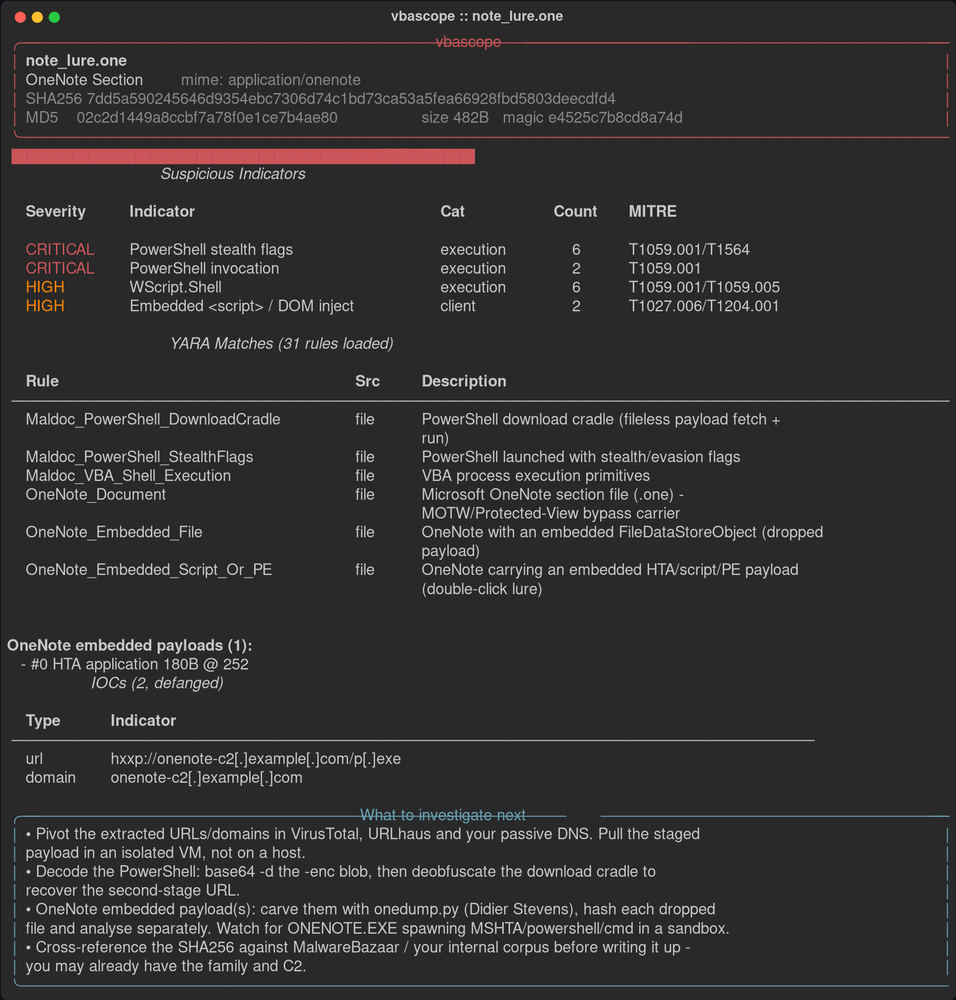
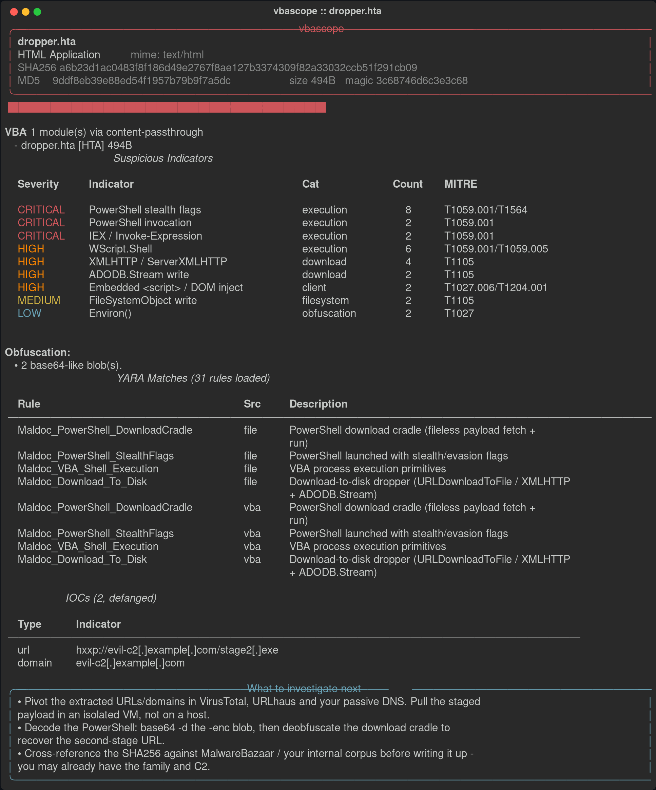
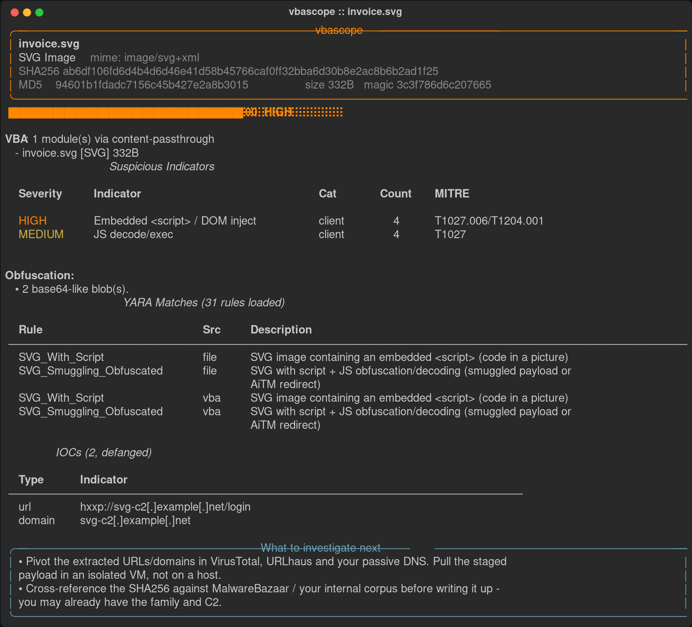
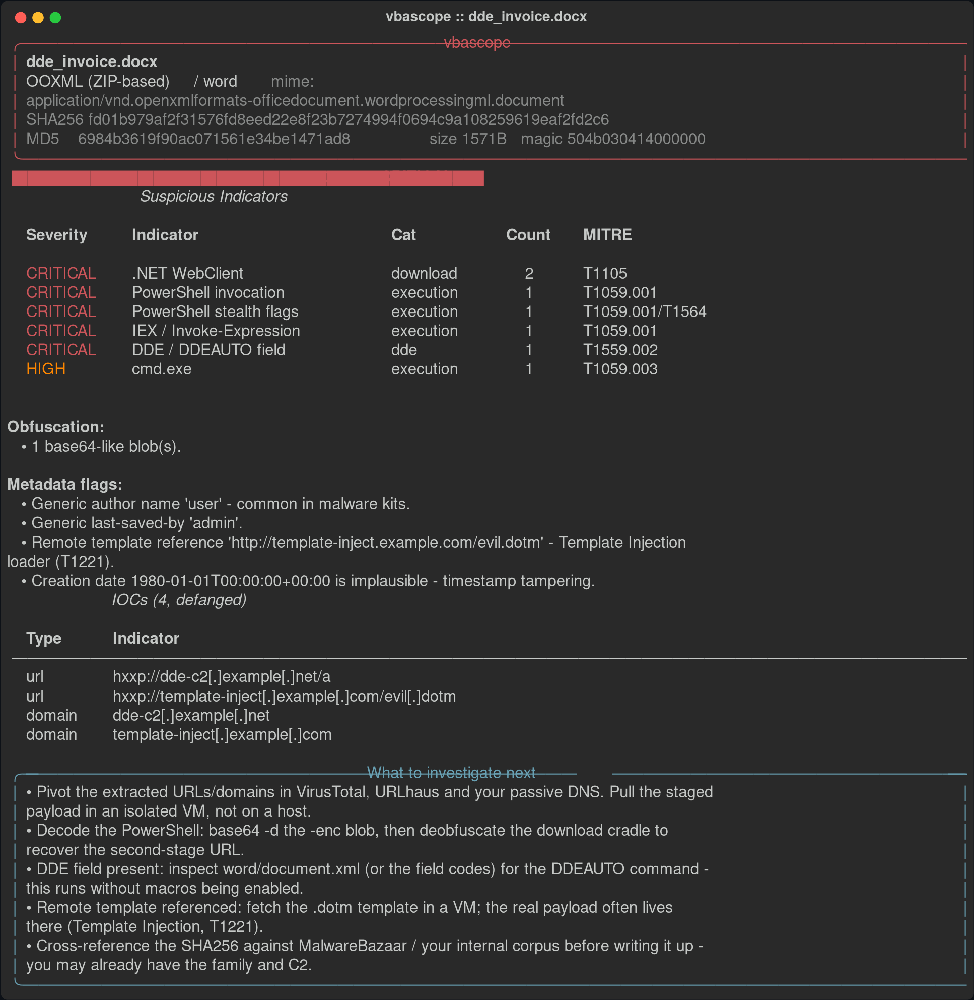

# vbascope

A malicious-document static analysis engine for VBA/macro extraction, modern
delivery-format triage, and IOC hunting. Hand it a suspicious Office file, RTF,
OneNote, SVG, HTML, PDF, LNK, XLL or script and get back extracted
macros/payloads, MITRE-mapped indicators, defanged IOCs, YARA matches, a risk
score, and terminal / JSON / HTML / CSV reports.

**vbascope performs static analysis only. It never executes macro code or
launches the sample.** Every string pulled from a sample is treated as
untrusted data and HTML-escaped before it reaches any report.

### Why it covers more than macros

Microsoft blocked internet-sourced Office macros by default in mid-2022 and VBA
delivery collapsed. Threat actors pivoted to formats that sidestep Mark-of-the-
Web and Protected View. vbascope targets that current surface:

| Vector | Status 2024-2026 | vbascope coverage |
|--------|------------------|-------------------|
| **SVG** | Dominant 2025 phishing attachment (~1800% growth) | script/CDATA/foreignObject detection, base64 C2 decode |
| **OneNote (.one)** | Major 2023-2024 loader (QakBot) | carves embedded HTA/LNK/PE payloads via FileDataStoreObject GUID |
| **LNK** | Common initial access | parses command line / arguments (MS-SHLLINK) |
| **HTML smuggling** | Widespread (T1027.006) | atob+Blob+download chain detection |
| **PDF** | Most common attachment | /JS /OpenAction /Launch /EmbeddedFile /URI triage |
| **XLL** | Excel add-in RCE, bypasses macro policy | pefile xlAutoOpen / Excel-DNA detection |
| **ISO/IMG/VHD** | Container smuggling | lure-reference detection |
| **VBA / XLM / RTF / DDE** | Legacy but still seen | full extraction (unchanged) |

---

## Screenshots

OneNote loader (`.one`) with an embedded HTA payload carved out of the
FileDataStoreObject, the dropped PowerShell download cradle, and the matching
OneNote YARA rules:



A classic macro-era HTA dropper, scored Critical:



SVG smuggling: the C2 URL is hidden in a base64 `atob()` blob, decoded and
extracted as an IOC:



A macro-less DDE/DDEAUTO docx with a remote template and tampered metadata:



## Example reports

- [HTML report (OneNote loader)](docs/reports/onenote_loader.html) and its
  [JSON](docs/reports/onenote_loader.json)
- [HTML report (HTA dropper)](docs/reports/hta_dropper.html) and its
  [JSON](docs/reports/hta_dropper.json)
- [Batch triage CSV](docs/reports/batch_triage.csv) (one row per file, sortable
  by risk)

The HTML reports are self-contained (inline CSS, no external calls). Download
and open them in a browser. Samples that produced these are inert test files,
not live malware.

---

## Features

- **Content-based file typing** - identifies OLE2 / OOXML / RTF / MHTML / HTA /
  HTML / script / OneNote / SVG / PDF / LNK / XLL / PE by magic bytes + libmagic,
  never by extension (maldocs lie about type; a `.svg` renamed to `.jpg` is
  still caught).
- **VBA extraction** via `oletools.olevba`, with a manual `vbaProject.bin`
  fallback for OOXML containers whose autodetection is defeated.
- **VBA stomping detection** (T1564.007) - flags modules whose source is blank
  while compiled p-code exists.
- **Excel 4.0 / XLM macro** extraction via `XLMMacroDeobfuscator`, hard-timed
  out in a worker process so anti-analysis stalls can't hang the tool.
- **RTF carrier analysis** - pulls embedded OLE objects (Equation Editor
  exploits, OLE Packages, embedded Office docs) and recurses into them for VBA.
- **Static indicator engine** - execution, download, obfuscation, persistence,
  evasion, filesystem, exploit (Follina/ms-msdt), smuggling and embedded-object
  signatures, each annotated with the MITRE ATT&CK technique it covers and why
  it matters.
- **IOC extraction + defanging** - URLs, domains, IPs, emails, Windows/UNC
  paths, registry keys. High-precision domain filtering (real-TLD allowlist)
  and `hxxp://`/`[.]` defanging for safe sharing.
- **YARA** - ships two built-in rulesets (31 rules): `default.yar` (VBA
  tradecraft - PowerShell cradles, base64 PE, Emotet/Dridex skeletons, DDE) and
  `modern_maldoc.yar` (OneNote, SVG smuggling, HTML smuggling, Follina/ms-msdt,
  XLL, LNK LOLBins, remote templates, ClickFix, PDF actions, container lures).
  Every `.yar`/`.yara` dropped into `rules/` is auto-loaded; `--yara` layers on
  custom rules. Scans both the raw file and the decompressed/decoded content. A
  single malformed rule file is isolated, not fatal.
- **Base64 decode layer** - folds one base64 (and base64-of-UTF-16LE) decode
  pass back into analysis, so smuggled URLs and PowerShell `-enc` payloads
  become visible to the IOC and signature engines.
- **Metadata** - OLE SummaryInformation and OOXML docProps, with flags for
  generic authors, remote templates (T1221) and impossible timestamps.
- **Risk scoring** (0-100) with an itemised breakdown and Clean/Low/Medium/
  High/Critical classification.
- **Four report formats** - rich colour terminal (exportable to SVG), machine-
  parseable JSON, a self-contained single-file HTML report with collapsible
  sections and syntax-highlighted VBA, and a batch triage CSV.
- **Bonus** - ZIP batch extraction (zip-slip-guarded), DDE/DDEAUTO detection in
  OOXML, script-file passthrough (.hta/.vbs/.wsf), password-protected document
  decryption (common malspam passwords), `--sandbox-prep` submission summary,
  and a "What to investigate next" section.

---

## Install

```bash
# Option A: let vbascope install its own deps (user-site first, PEP-668 fallback)
python3 vbascope.py --setup

# Option B: pip
python3 -m pip install -r requirements.txt
```

Dependencies: `oletools`, `yara-python`, `XLMMacroDeobfuscator`, `pefile`,
`python-magic`, `rich`, and (optional) `msoffcrypto-tool` for encrypted docs.
Optional system tools `exiftool`, `file`, `strings` improve results; vbascope
warns if they're missing but never blocks.

> vbascope never uses `sudo` and never reads any ambient password variable.
> Installing analysis tooling should not require root.

---

## Usage

```bash
vbascope analyze <file_or_directory> [options]

  --output-dir DIR     output directory (default: ./vbascope_output/)
  --json               write JSON report
  --html               write HTML report
  --csv                write a one-row-per-file CSV (batch triage)
  --yara RULES_PATH    custom YARA rules file/dir (layered on the defaults)
  --dump-vba           save extracted VBA modules to files
  --verbose            debug-level logging
  --quiet              only risk score and critical/high findings
  --no-color           disable terminal colors
  --sandbox-prep       emit an ANY.RUN / Joe Sandbox / VT submission summary
  --setup              check/install dependencies first
```

### Examples

```bash
# Single file, full reports
vbascope analyze invoice.docm --json --html --dump-vba

# Batch a directory (recurses; also expands .zip bundles) -> one triage CSV
vbascope analyze ./quarantine/ --csv --json

# Modern formats work the same way
vbascope analyze note.one          # carves embedded OneNote payloads
vbascope analyze invoice.svg       # SVG smuggling + base64 C2 decode
vbascope analyze resume.lnk        # parses the LNK command line
vbascope analyze addin.xll         # confirms xlAutoOpen / Excel-DNA

# Custom YARA on top of the built-ins, sandbox summary
vbascope analyze sample.xls --yara ./myrules/ --sandbox-prep
```

### Exit codes

| Code | Meaning                                    |
|------|--------------------------------------------|
| 0    | analyzed, nothing high/critical            |
| 2    | bad input (target missing / no files)      |
| 3    | at least one file scored High or Critical  |

Code `3` makes vbascope easy to gate in CI / detonation pipelines.

---

## Project layout

```
vbascope/
├── vbascope.py              CLI entrypoint + orchestrator + risk scoring
├── extractors/              vba / xlm / rtf / metadata + modern_formats
│                            (OneNote, PDF, LNK, XLL)
├── analyzers/               static signatures, IOCs, obfuscation, YARA
├── reporters/               terminal (rich), JSON, HTML, CSV
├── rules/
│   ├── default.yar          legacy VBA/XLM/DDE tradecraft
│   └── modern_maldoc.yar    OneNote/SVG/HTML-smuggling/Follina/XLL/LNK/PDF
├── utils/                   hashing, file identification, dependency mgmt
├── requirements.txt
└── README.md
```

Drop any additional `.yar`/`.yara` into `rules/` and it is auto-loaded on the
next run - no code change needed.

---

## How the risk score works

| Signal                                   | Points           |
|------------------------------------------|------------------|
| Auto-execution trigger (Auto_Open, ...)  | +20 each         |
| Execution capability (Shell/WMI/PS)      | +15 per distinct |
| Download capability (XMLHTTP/WebClient)  | +15 per distinct |
| Dynamic execution (Execute/Eval)         | +15 / +10        |
| Persistence (Run key, schtasks)          | +10 per distinct |
| Evasion (sandbox checks, Sleep)          | +10 per distinct |
| Embedded PE / DDE field                  | +25 / +20        |
| VBA stomping                             | +15              |
| Obfuscation (density/base64/entropy)     | sub-score ≤30    |
| Suspicious metadata                      | +5 each          |
| YARA match                               | +10 each         |

Capped at 100. `0-20 Clean · 21-40 Low · 41-60 Medium · 61-80 High · 81-100
Critical`.

---

## Notes & limitations

- Static only. A High/Critical score means "has the capability and the
  tradecraft", not "detonated and confirmed". Pair with a sandbox.
- Deep VBA p-code analysis (for confirmed stomping) is out of scope - dump the
  p-code with `pcodedmp` / `olevba --show-pcode` as the next step (vbascope tells
  you when).
- `.rar` / `.7z` archive expansion needs external tooling and is skipped with a
  note; `.zip` is handled natively.
- The default YARA rules favour readability and teaching value over
  false-positive tuning. Extend them for your own corpus.
